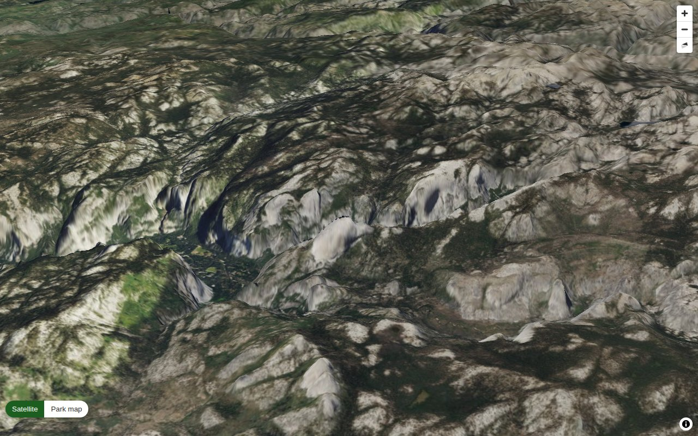
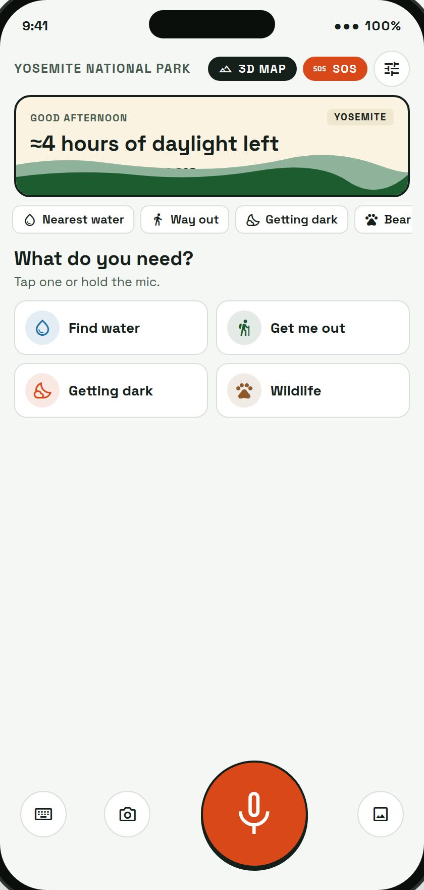
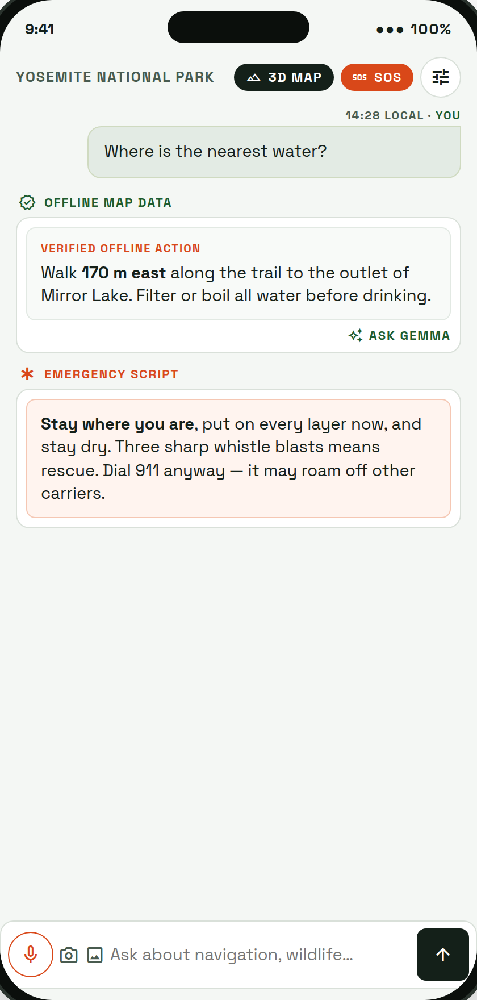
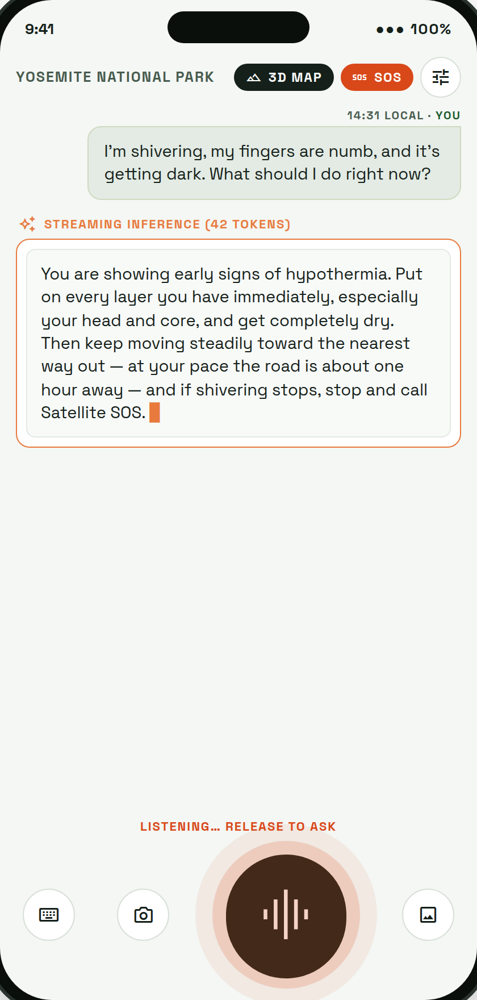
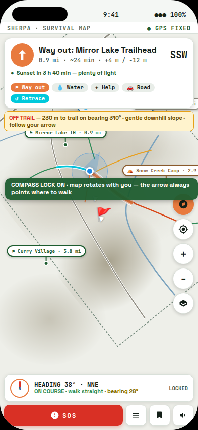
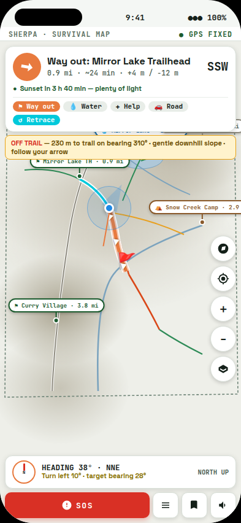
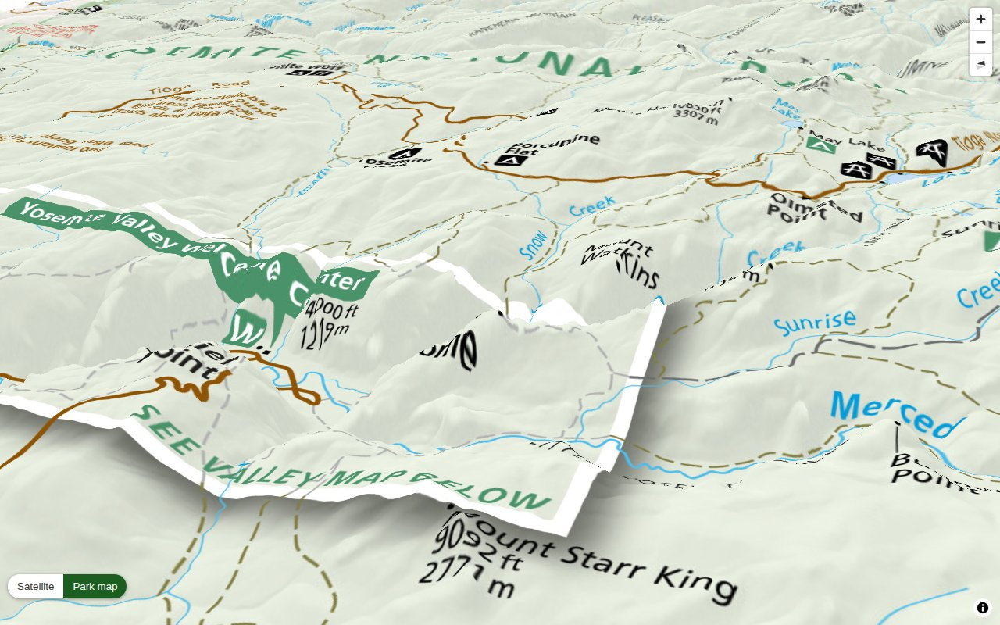
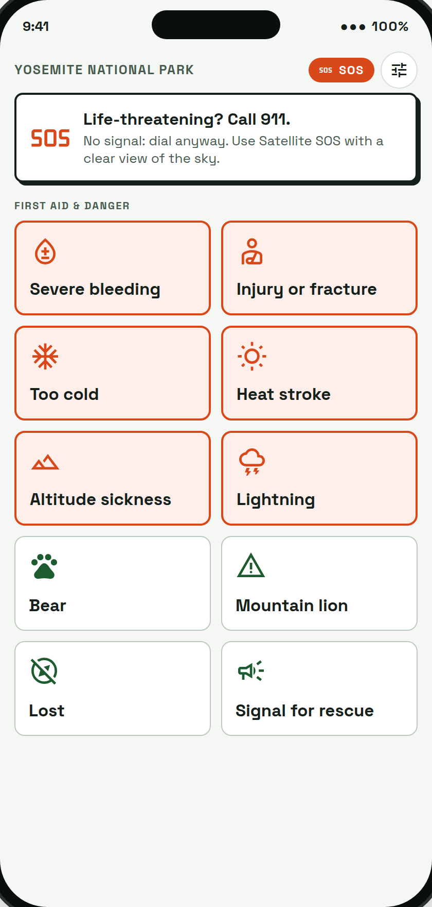
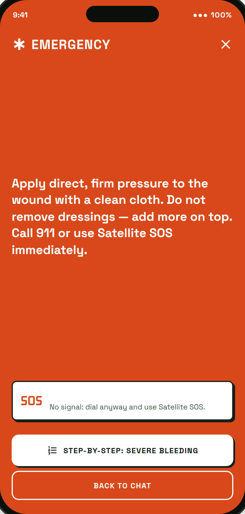
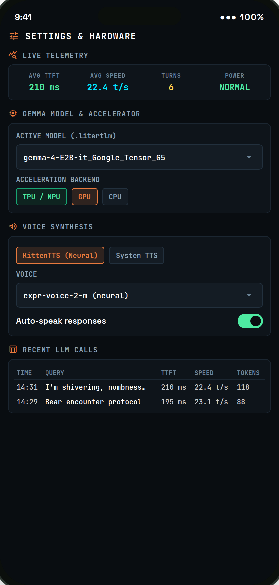

# Sherpa

## Voice-First Offline Survival Assistant — built for anyplace

> **An on-device survival assistant that runs a Gemma LLM on Google Tensor, renders terrain in 3D, and answers navigation, first-aid, and safety questions anywhere — with zero network connection. Demonstrated here with Yosemite National Park.**

[](#technical-design)
[](#tests)
[](#development-map-tools)
[](#build-and-run)
[](ARCHITECTURE.md)



*Real offline 3D map rendered by the app (demonstration region: Yosemite). Every tile is served locally — no signal required.*

| | |
|---|---|
| Hackathon track | **Mobile AI** |
| Platform | **Android** (Google Pixel with Tensor NPU) and **iOS** (iPhone with LiteRT-LM for Swift) |
| Primary model | **Gemma 4 E2B** via LiteRT-LM, on-device |

---

## Why Sherpa

Every wild place on Earth shares the same problem: **cell service disappears exactly where you need it most**. In the US national parks alone — Yosemite, Grand Canyon, Glacier, Yellowstone, Zion — backcountry valleys have virtually no connectivity, and every season hikers are stranded by darkness, hypothermia, twisted ankles, and swollen rivers, often less than a mile from a trail.

Sherpa is a **voice-first offline survival assistant built for anyplace**: you hold the mic and ask questions, and it answers from local data. The platform is **region-agnostic** — drop in any park map (GeoPDF), elevation data, and safety guide, and the same voice assistant, 3D/2D maps, and route-out intelligence work for that region. **Yosemite is bundled as the demonstration region pack.**

A four-tier answer strategy keeps critical responses instant:

1. **Deterministic quick cards** for common lookups ("Where is the nearest water?", "How do I get out?") served from bundled map data in **< 100 ms** — never through a text generator.
2. **The official NPS-aligned first-aid and hazard guide** for known dangers (bears, hypothermia, heat stroke, altitude, lightning).
3. **Gemma 4 E2B**, running locally on the device's NPU, for open-ended judgement questions ("I'm shivering, my fingers are numb, and it's getting dark — what should I do right now?").
4. **Immediate scripted emergency guidance** the instant a life threat or missing person is detected — before any model call — because nothing should stand between a human life and 911 / Satellite SOS.

No account. No telemetry. No cloud. Every byte stays on the phone.

---

## Region packs — built for anyplace

The assistant is architected around **region packs**, not hardcoded to one park. Adding a new region is a one-time pipeline run on a laptop:

```bash
# 1. Download ANY park's official GeoPDF map (e.g. Grand Canyon, Glacier, Yellowstone…)
curl -L -o data/grand_canyon.pdf '<NPS GeoPDF URL>'

# 2. Build the full offline pack: MBTiles map tiles + 3D terrain + aerial imagery
.venv/bin/python scripts/build_android_assets.py data/grand_canyon.pdf --tiles --terrain --imagery

# 3. Pull OpenStreetMap trails, POIs and DEM elevation for any bounding box
python tool/build_geo.py --bbox <lat1> <lat2> <lon1> <lon2> --region "Grand Canyon"
```

The app's trail router (Dijkstra + DEM slope), solar calculator (NOAA, any latitude/longitude), first-aid guide, emergency mode, and Gemma survival briefs all work identically for any region pack. The demo region (Yosemite) comes pre-built in the repo.

---

## Visual tour

*All screens shown below use the Yosemite demonstration dataset.*

### Survival dashboard & verified offline answers

| Survival dashboard (daylight, elevation, quick actions) | Offline map-data answer with verified action badge |
|---|---|
|  |  |

### Streaming Gemma brief & compass-locked survival map

| Streaming Gemma tactical brief with live inference telemetry | Survival map in heading-up compass mode: the map rotates with you, the arrow always points where to walk |
|---|---|
|  |  |

### Survival-first trail map & the printed park map in 3D

| Survival map: destination arrow, distance/ETA, sunset countdown, grade-coded trails, off-trail escape bearings, one-tap SOS | The printed NPS park map draped over the 3D terrain |
|---|---|
|  |  |

### First-aid guide & emergency takeover

| Browsable offline guide: 10 urgent first-aid and hazard topics | Full-screen emergency takeover with immediate scripted instructions |
|---|---|
|  |  |

### Hardware control & latency benchmarks



---

## Feature matrix

| Capability | How it works | Offline |
|---|---|:---:|
| **Voice & text Q&A** | Zipformer ASR transcribes on-device; KittenTTS speaks answers | Yes |
| **Question routing** | Laya zero-shot classifier picks template / guide / Gemma; rule-based fallback when Laya is unavailable | Yes |
| **Emergency response** | Keyword + classifier cue triggers instant scripted guidance + 911/SOS call to action | Yes |
| **Survival map** | Destination arrow with live bearing delta, distance/ETA, sunset countdown, off-trail escape bearings, grade-coded trails, one-tap SOS | Yes |
| **Compass lock** | Heading-up mode rotates the map to your heading so the arrow always points where to walk | Yes |
| **Offline 2D map** | NPS Park Tiles vector overlay + DEM hillshade + auto-computed route out (Naismith estimates) | Yes |
| **Full offline 3D map** | MapLibre 3D screen: aerial imagery or the printed park map draped over real terrain, place search, safety guidance per spot — tap **3D MAP** on the home screen | Yes |
| **First-aid guide** | Bundled curated guide with BM25 retrieval, step-by-step view, and read-aloud | Yes |
| **Battery awareness** | Normal / saver / critical power tiers adjust GPS interval and defer Gemma when battery is low | Yes |
| **Model & backend control** | TPU/NPU (Tensor G5), GPU (OpenCL), CPU selection; KittenTTS voice picker; LLM latency table | Yes |
| **Region packs** | Drop in any GeoPDF park map + DEM + OSM data; platform works for any wild place | Yes |
| **Inspectable decisions** | Long-press any answer to see why it was routed and the exact Gemma prompt | Yes |
| **Demo mode** | No park GPS required: the app simulates a hiker for the active region | — |

---

## Architecture

```text
                               ┌────────────────────────────────────────────────────────┐
                               │                    SHERPA APP                          │
                               └────────────────────────────────────────────────────────┘

    Voice ──────▶  Zipformer ASR ─────┐
                   (on-device, LiteRT)│
                                      ▼
                   Question text ──▶  Laya router ──┬── instant cards ◄── region park data + DEM
                   (or typed)        (on-device,     ├── official guide ◄── guide.md (BM25)
                                      LiteRT)        └── Gemma 4 E2B ──▶ streaming answer
                                                          │                 │
                                                   LiteRT-LM              KittenTTS
                                                   (Tensor NPU)           (on-device)
                                                          ▲
                                                          │
    Location ───▶  GPS + DEM elevation ─── situational context
                   + sunset computation    (elevation, light left, battery, route-out)
```

| Component | Role | Runtime |
|---|---|---|
| Zipformer | Speech recognition | On-device, LiteRT |
| Laya | Zero-shot question classification | On-device, LiteRT |
| Gemma 4 E2B | Open-ended survival reasoning | On-device, LiteRT-LM (TPU/NPU on Pixel) |
| KittenTTS | Neural speech synthesis | On-device, LiteRT |
| Region data & guide | Reference content (any place) | Bundled with the app |
| Trail router | Way-out routing + Naismith estimates | Pure Dart, offline DEM + trail graph |
| Offline 3D map | MapLibre terrain + imagery/park-map drape | Native screen (Android `Map3dActivity`, iOS `Map3dViewController`), tiles served locally |

Flutter implements the UI, location services, retrieval, routing policy, and the tactical 3D HUD. Android (Kotlin) and iOS (Swift) each host the LiteRT inference runtime and audio pipeline behind a shared method-channel contract (`survival/ai`, `survival/map3d`).

---

## Build and run

### Android (Pixel evaluation)

Requires Flutter 3.x, Android SDK/ADB, JDK 17, and an ARM64 Android device. The **Tensor G5 NPU model** requires a compatible Google Pixel. Model files are several gigabytes and must be obtained separately — they are not included in the APK.

```bash
# 1. Download/collect the models (Gemma 4 E2B, Zipformer, Laya, KittenTTS)
export MODELS="$HOME/Personal/gemma-models/models"
sh tool/fetch_models.sh

# 2. Build and install the APK
flutter pub get
flutter build apk --release --target-platform android-arm64
adb install -r build/app/outputs/flutter-apk/app-release.apk

# 3. Launch the app once, then push models to external storage
sh tool/push_models.sh
```

Grant microphone and location permissions when prompted. The app includes a demo mode that simulates a hiker in the active region, so no real park GPS is required for evaluation.

### iOS

```bash
flutter pub get
open ios/Runner.xcworkspace        # or: cd ios && pod install
# Select an ARM64 iOS device in Xcode and run
```

The iOS build uses the federated plugin `packages/sherpa_ios` (LiteRT-LM for Swift, Apple speech recognition and synthesis, and a `WKWebView` 3D map with a custom `sherpa-map://` tile scheme).

### Building offline 3D tilesets for any region

The 3D map toolchain included in `geopdf_locator/` turns **any official park map PDF** into the app's offline 3D datasets:

```bash
python3 -m venv .venv && .venv/bin/pip install -e '.[dev]'

# Download the park's official GeoPDF map (Yosemite demo shown here)
mkdir -p data && curl -L -o data/yosemite.pdf \
  'https://npgallery.nps.gov/HFC/GetAsset/c51f64fd-51dc-400e-b562-d02789c95933/original.pdf'

# Build PDF map tiles, elevation terrain, and aerial imagery into assets/
.venv/bin/python scripts/build_android_assets.py data/yosemite.pdf --tiles --terrain --imagery
```

This writes `yosemite.mbtiles` (~8 MB, zooms 9–13), `yosemite-terrain.mbtiles` (~6.6 MB, AWS Terrarium DEM), and `yosemite-imagery.mbtiles` (~15 MB, USDA/USGS aerial imagery). The app finds them automatically and the **3D MAP** button opens the viewer.

You can also preview the same 3D map in a desktop browser:

```bash
.venv/bin/python tools/map-viewer/serve.py 8766 \
  --tiles pdf=assets/maps/yosemite/yosemite.mbtiles \
  --tiles terrain=assets/maps/yosemite/yosemite-terrain.mbtiles \
  --tiles imagery=assets/maps/yosemite/yosemite-imagery.mbtiles \
  --static assets/map3d
# open http://127.0.0.1:8766/
```

---

## Evaluation walkthrough

| Test prompt | Expected source | What to check |
|---|---|---|
| "Where is the nearest water?" | **Offline map data** | Distance + bearing, "VERIFIED OFFLINE ACTION" badge, filter/boil reminder |
| "How do I get out of here?" | **Offline map data** | Computed route out with distance, ascent, Naismith estimate, compass heading |
| "I'm shivering, my fingers are numb, and it's getting dark — what should I do?" | **Gemma (streaming)** | Immediate hypothermia action first, road time estimate, Satellite SOS advice |
| "There's a bear near me" | **Guide / scripted** | Non-generated safety content, step-by-step view |
| "My friend fell and is bleeding badly" | **Emergency script** | Emergency takeover appears instantly, 911/SOS banner, no LLM in the loop |
| "How do I cross this river?" | **Guide** | BM25 retrieval of river-crossing guide section |
| "Tell me a joke" | **Gemma** | Routed as off-topic to Gemma rather than answered with survival content |
| "What is the capital of France?" | **Gemma** | Out-of-domain query handled gracefully |

After each answer, **long-press the card** to see how Laya classified the query and, for Gemma answers, the exact prompt assembled from situational context.

Use the **demo mode** (long-press the map to move the simulated hiker anywhere in the region, then tap the GPS button to return). For the offline 3D map, tap **3D MAP** in the top bar; inside it, use the search box to fly to any place and read that spot's safety guidance, and the **Satellite / Park map** buttons to switch drape modes. On the Trail Map, use the **compass lock** button (🧭) to rotate the map with your heading, the **3D** button for the full offline 3D map, and the **SOS** button for emergency mode.

---

## Tests

```bash
# Flutter unit & widget tests (routing, DEM, way-out router, solar calculations, survival map)
flutter test -r expanded

# Python map-tool tests (58 tests against the real NPS map)
.venv/bin/pytest -v
```

All 23 Flutter tests and all 58 map-tool tests pass; `flutter analyze` reports zero issues.

---

## Offline map tools (`geopdf_locator`)

A set of Python tools that turn **any official NPS park map (a GeoPDF)** into offline data: place-name lookup, the map's own safety notes linked to places, MBTiles map tiles, and 3D terrain and imagery. It was designed from the start to handle any park map — Grand Canyon, Glacier, Yellowstone, and more.

### Place lookup

```python
from geopdf_locator import GeoPdfMap
m = GeoPdfMap.open("data/yosemite.pdf")
best = m.locate("Half Dome")[0]
best.lat, best.lon          # (37.74603, -119.53303)
m.to_page(37.75, -119.55)   # GPS fix -> page point, for a "you are here" marker
```

```bash
geopdf-locate data/yosemite.pdf "Half Dome" "Glacier Point" --all
geopdf-locate data/yosemite.pdf "Half Dome" --render out/half_dome.png
```

`--render OUT.png` draws the best hit: a close-up (label boxed, crosshair on the anchor, coordinates captioned) and a whole-map overview.

### How it works

1. **Georeference** – reads the page's `/VP` → `/Measure /GEO` dictionary (control points `GPTS`/`LPTS`, coordinate system `GCS`) and fits an affine transform from page space to projected space.
2. **Find labels** – searches a character stream so curved road labels stored one glyph per block are reconstructed as full labels.
3. **Snap to symbol** – labels sit beside their features (1–2 km off), so the locator anchors to map symbols (leader lines, dots, icons), with exact type ranking.
4. **Rank** – exact labels > snapped > via leader > larger type; all hits returned for disambiguation.

Median error on the Yosemite demonstration map over 29 reference places: ~170 m (peaks and viewpoints within 20–170 m), vs ~1.3 km for raw label centres.

### Safety guidance linked to places

```bash
geopdf-locate data/yosemite.pdf "Olmsted Point" --guidance
# WARNING  Tioga Road closed approx. November to May east of this point
# INFO     Facilities along Tioga Road available summer only
geopdf-locate data/yosemite.pdf --at 37.873,-119.36      # guidance for a GPS position
```

Notes (closures, limits, hazards, seasonal facilities) are text blocks with advisory wording, merged when printed together, anchored via arrows, and traced along the road they name. Warnings rank before info; legend sentences become park-wide notes.

### MBTiles map tiles

```bash
python -m geopdf_locator.tiles data/yosemite.pdf out/yosemite.mbtiles --max-zoom 14
```

Renders the GeoPDF into a standard MBTiles raster tileset (JPEG, Web Mercator, zooms 9–14: 2,471 tiles, ~24 MB, ~2 min). Tiles are drawn from vector content at each zoom so text stays sharp. Zoom 14 is ~7.5 m/px; use `--max-zoom 13` for ~8 MB.

### NPS Park Tiles overlay (vector)

```bash
python scripts/extract_park_tiles.py data/yosemite.pdf out/parktiles [--mbtiles]
```

Cuts the GeoPDF's footprint out of the NPS nationwide [Park Tiles](https://www.nps.gov/maps/web/blog/tilejson/index.html) vector tilesets with HTTP range requests: ~15 s, ~23 MB for the demo region — boundary, data (roads/trails/buildings), hydro, and 511 named label points. Public domain NPS/USGS data.

### 3D terrain and imagery

```bash
python -m geopdf_locator.terrain data/yosemite.pdf out/yosemite-terrain.mbtiles --max-zoom 11
python -m geopdf_locator.imagery data/yosemite.pdf out/yosemite-imagery.mbtiles --max-zoom 13
```

Terrain Tiles on AWS (Terrarium encoding, zooms 8–11: 6.6 MB) and USDA/USGS aerial imagery (zooms 9–13: 14.8 MB). The app drapes the imagery (or the park map) over terrain in 3D.

### Native Android demo (`android-native/`)

The survival app itself is the Flutter app in `android/` + `lib/`. A separate Kotlin demo shows the PDF-derived map pack on a phone without parsing the PDF: `python scripts/build_android_assets.py data/yosemite.pdf` exports a ~2 MB offline map pack, and Kotlin parity tests verify it against this Python pipeline. See [android-native/README.md](android-native/README.md).

### Development (map tools)

```bash
python -m venv .venv && .venv/bin/pip install -e '.[dev]'
mkdir -p data && curl -L -o data/yosemite.pdf 'https://npgallery.nps.gov/HFC/GetAsset/c51f64fd-51dc-400e-b562-d02789c95933/original.pdf'
.venv/bin/pytest
```

Tests against the real map are skipped when `data/yosemite.pdf` (or `$YOSEMITE_MAP_PDF`) is missing; the synthetic-GeoPDF tests always run.

---

## Demo video

A 2-minute walkthrough showing every feature of the app — voice Q&A, the four-tier answer strategy, the offline 3D and 2D maps, the first-aid guide, emergency mode, and hardware controls — is included in the repository:

[**Watch the 2-minute demo**](docs/demo/sherpa_demo_2min.mp4)

---

## Responsible-use note

Sherpa is a prototype for evaluation. Reference data (maps, trails, points of interest) are snapshots and do **not** reflect live trail conditions, weather, closures, or water availability. The app cannot summon help or dispatch rescuers. In any emergency, call **911** (even without service — calls can roam) or use **Satellite SOS** with a clear view of the sky.

---

## License & attribution

Model assets and geographic data are subject to their respective licenses — see [ARCHITECTURE.md](ARCHITECTURE.md) for the complete model inventory and attribution list. NPS Park Tiles and aerial imagery are U.S. government public domain works.
