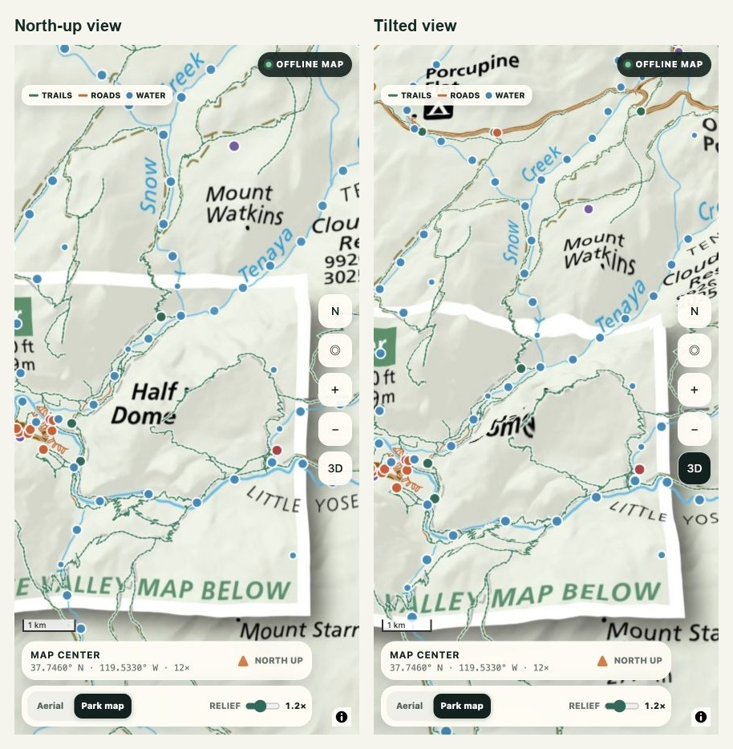
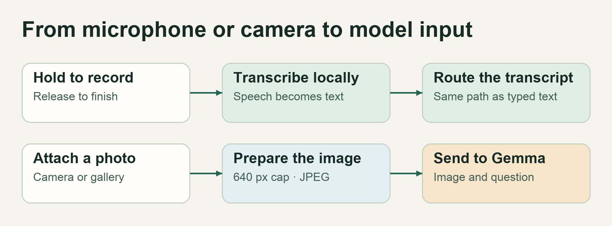

# Sherpa Survival: Offline AI Assistant for Outdoor Adventures

## The problem

You’re on a camping trip, walking on a quiet trail when it starts to rain. It’s getting dark, and it’s been a while since you passed a trail marker. You stop to check the map on your phone. No signal.

Then you remember you installed Sherpa Survival. You open it and see your position, the nearby trails, and the path you’ve walked so far.

On your way back to the trailhead, you make out the shape of a bear in the distance. You whisper, “I see a bear. What should I do?” Sherpa can pull up its offline wildlife guide right away. You keep your distance and give the bear room. Later, back at the campsite, you ask how to start a fire.

We built Sherpa Survival to make that possible on Android and iOS.

Sherpa uses your location history, local terrain, and a field guide to answer questions offline, even if you’ve wandered off the mapped trail.

## What we built

Sherpa calculates routes from the offline map, answers common safety questions from its field guide, and uses Gemma for questions that need judgment.

### A track gives the assistant more than a pin

Sherpa records latitude, longitude, and time when a new fix is 25 metres away or two minutes newer than the last recorded point. It gets current elevation from the offline terrain grid or the phone’s altitude reading.

Retrace follows the recorded points in reverse. Gemma can use how far you’ve moved in the past hour alongside the route planner’s walking estimate, which uses distance and ascent.

*Retrace with a simulated GPS track to Happy Isles Trailhead.*

In Yosemite, the planner uses Dijkstra’s algorithm to find a route through trail segments that store coordinates, distance, and elevation change. MapLibre draws the route, recorded track, and current position, along with a bearing back to the trail when you’re off it.

MapLibre drapes the Park map or aerial imagery over a mesh built from local elevation tiles. Tap **3D** to tilt the camera over the selected layer.

### Speech and photos take different paths

Hold to record and release to transcribe. On Pixel, Zipformer takes up to 16 seconds of 16 kHz audio and passes the transcript to the text router.

Sherpa caps the longest edge of a photo at 640 pixels, compresses it as JPEG, and sends it to Gemma with the question.

### When a text question needs Gemma

Laya scores intent, urgency, and the need for reasoning. The app combines those scores with cues in the text. “Where’s the nearest trailhead?” goes to the route planner. “Should I keep going or head back?” goes to Gemma with local context such as daylight, recent progress, the route out, and a guide excerpt.

## How we used LiteRT

Flutter handles the interface and route calculations. It calls the native models through a method channel and receives generated tokens over an event channel. We used preconverted LiteRT Community models from Hugging Face so we could spend the hackathon integrating them and testing on the Pixel.

| Stage | Model | Runtime | Pixel backend |
| --- | --- | --- | --- |
| Speech recognition | Zipformer CTC | LiteRT | GPU |
| Text classification | Laya Multilingual | LiteRT | GPU |
| Text and image generation | Gemma 4 E2B-it | LiteRT-LM | Tensor G5 NPU with the optimized bundle |
| Text-to-speech | KittenTTS nano | LiteRT | CPU |

LiteRT-LM runs Gemma 4 E2B on Android and iOS. The standard E2B bundle is **2.59 GB**, compared with **3.66 GB** for E4B. Sherpa loads Gemma on demand, reuses it for follow-ups, and releases it after five idle minutes. On a compatible Pixel, the app can retry on the GPU with the standard bundle if the optimized TPU bundle fails to load. [E2B model files](https://huggingface.co/litert-community/gemma-4-E2B-it-litert-lm/tree/main) · [E4B model files](https://huggingface.co/litert-community/gemma-4-E4B-it-litert-lm/tree/main)

### Pixel GPU vs. TPU

| Hardware & backend | Prefill (tok/s) | Time to first token | Decode (tok/s) | Peak CPU RAM |
| --- | ---: | ---: | ---: | ---: |
| Pixel TPU (Tensor delegate) | 2,500–3,500 | ~0.2–0.4 s | 30–45 | ~0.7–1.0 GB |
| Pixel GPU (OpenCL/Vulkan) | 2,000–3,000 | ~0.3–0.5 s | 40–50 | ~1.0–1.2 GB |

*Reference ranges for Pixel inference.*

## Demo

[Watch the two-minute hackathon demo](https://github.com/dev-ansung/sherpa-survival/blob/238d878bbd37f44df30574fbe2f1dabc3bef2d48/docs/demo/sherpa_demo_2min.mp4) · [Explore the GitHub repo](https://github.com/dev-ansung/sherpa-survival)

## What we learned

**Transcribe first.** A local transcript lets Laya route voice questions while Gemma is still unloaded.

**Try real questions.** Laya matched guide topics more consistently than it classified broad intent. Combining its scores with cues in the question helped us distinguish a lookup from a request for advice.

**Put the model controls in Settings.** Switching the model, accelerator, and voice on the Pixel let us test configurations and show the differences during the demo.

**Measure from the tap.** Time from submission to first visible text includes the model load the hiker waits for.

## What’s next

We want hikers to download region packs for parks beyond Yosemite and carry the same offline map, field guide, and assistant into new terrain.

## Team

- An Sung · [LinkedIn](https://www.linkedin.com/in/dev-ansung/)
- Anirudh Kulkarni · [LinkedIn](https://www.linkedin.com/in/anirudh-kulkarni1/)
- Chengjiang Long · [LinkedIn](https://www.linkedin.com/in/chengjiang-long-a7702478)
- Min Thant Kyaw · [LinkedIn](https://www.linkedin.com/in/min-thant-kyaw-3075901b7)
