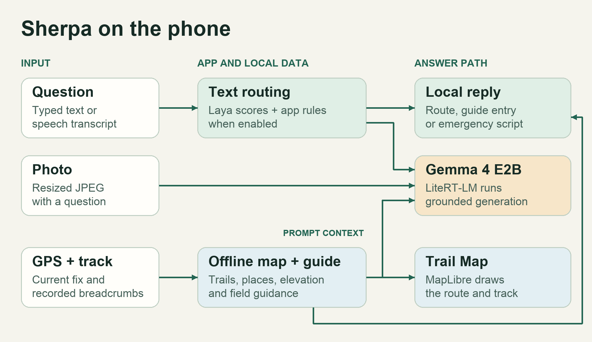
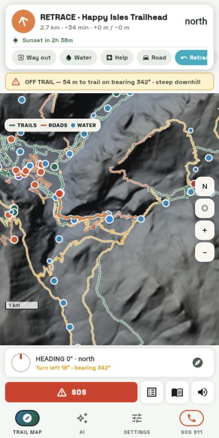
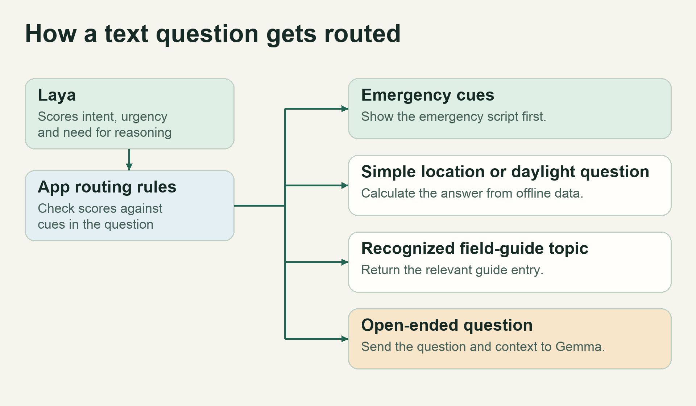

# Sherpa Survival: Offline AI Assistant for Outdoor Adventures

## The problem

You’re on a camping trip, walking on a quiet trail when it starts to rain. It’s getting dark, and it’s been a while since you passed a trail marker. You stop to check the map on your phone. No signal.

Then you remember you installed Sherpa Survival. You open it and see your position, the nearby trails, and the path you’ve walked so far.

On your way back to the trailhead, you make out the shape of a bear in the distance. You whisper, “I see a bear. What should I do?” Sherpa can pull up its offline wildlife guide right away. You keep your distance and give the bear room. Later, back at the campsite, you ask how to start a fire. [Yosemite wildlife guidance from the National Park Service](https://www.nps.gov/thingstodo/wildlife-safety-in-yosemite.htm)

We built Sherpa Survival to make that possible on Android and iOS.

Lose cell service and the phone can still get a GPS fix. The hard part is turning that fix into useful help. A dot tells you where you are. Your track tells you how you got there, even if you’ve wandered off the mapped trail. With the trail network, terrain, and a field guide on the phone, Sherpa can use that context to answer questions offline.

## What we built

Sherpa has three ways to answer. A map lookup calculates a result from local data. A field-guide question can return a bundled entry. When a question calls for an explanation or judgment, Sherpa gives Gemma the relevant local facts and streams its response. In an emergency, a scripted answer appears first.

### A track gives the assistant more than a pin

While tracking, Sherpa adds a breadcrumb when a new fix is at least 25 metres from the last recorded point or at least two minutes newer. It saves latitude, longitude, and time. For current elevation, it checks the offline elevation grid, then falls back to device altitude if needed.

Retrace draws those recorded points in reverse. The app also adds up how far you moved in the last hour and shares that figure with Gemma. That’s an estimate of recent progress that includes stops. The route planner calculates walking time separately from route length and ascent, so Gemma can explain the route estimate alongside the pace you’ve actually been making.

*The Trail Map browser preview uses a simulated Yosemite track. Retrace follows the recorded points.*

The Yosemite pack represents trails as connected segments with coordinates, length, and elevation change. Trailheads and water sources are points. The planner searches that network for a route, and MapLibre renders the route, track, and position. When the hiker is off trail, the map can also show the distance and bearing to the nearest trail.

With local elevation tiles, MapLibre builds a terrain mesh and drapes the georeferenced Park map or aerial imagery over it. Both the raster and the route overlays use the same coordinates. Tap **3D** and the camera tilts over the layer you already selected.

*Phone-width captures of the MapLibre terrain preview with local Yosemite tiles.*

### Speech and photos take different paths

Push-to-talk bounds the recording to a press. The Pixel implementation captures 16 kHz audio in chunks and caps each clip at 16 seconds, the transcription window used by Zipformer. It skips clips shorter than a quarter second. On release, the transcript enters the same router as typed text.

For photos, Sherpa caps the longest edge at 640 pixels and compresses the result as JPEG. The dimension cap bounds the input to the vision encoder. JPEG compression reduces the bytes passed to the runtime. Gemma gets the image and question together.

### When a text question needs Gemma

“Where’s the nearest trailhead?” can be answered with coordinates and a calculated route. “Should I keep going or head back?” calls for judgment. Laya scores the text for intent, urgency, and whether it needs reasoning. The app checks those scores against cues in the question before selecting an answer path. Laya can also help pick a field-guide topic, which gives Gemma a useful excerpt when it does run.

## How we used LiteRT

The Flutter app handles the interface, routing policy, and geospatial calculations. Native code runs the models. The runtime sends generated tokens back to Flutter as they arrive. This is the hardware configuration we targeted for the Pixel build.

| Stage | Model | Runtime | Pixel backend |
| --- | --- | --- | --- |
| Speech recognition | Zipformer CTC | LiteRT | GPU |
| Text classification | Laya Multilingual | LiteRT | GPU |
| Text and image generation | Gemma 4 E2B-it | LiteRT-LM | Tensor G5 NPU with the optimized bundle |
| Text-to-speech | KittenTTS nano | LiteRT | CPU |

LiteRT-LM runs Gemma on Android and iOS. We chose E2B for on-device text and image inference. Its standard LiteRT-LM bundle is about **2.59 GB** on disk, compared with **3.66 GB** for the standard E4B bundle. Once the app needs Gemma, it loads the engine and keeps it warm for follow-ups, then releases it after five idle minutes. On a compatible Pixel, Sherpa can retry on the GPU with an installed generic bundle if the NPU bundle fails to load. The map and guide stay available while Gemma is unloaded. [E2B model files](https://huggingface.co/litert-community/gemma-4-E2B-it-litert-lm/tree/main) · [E4B model files](https://huggingface.co/litert-community/gemma-4-E4B-it-litert-lm/tree/main)

### Performance reference ranges

| Hardware & backend | Prefill (tok/s) | Time to first token | Decode (tok/s) | Peak CPU RAM |
| --- | ---: | ---: | ---: | ---: |
| iPhone GPU (Metal) | 2,800–3,800+ | ~0.1–0.3 s | 50–60+ | ~1.4 GB |
| Pixel TPU/NPU (Tensor delegate) | 2,500–3,500 | ~0.2–0.4 s | 30–45 | ~0.7–1.0 GB |
| Pixel GPU (OpenCL/Vulkan) | 2,000–3,000 | ~0.3–0.5 s | 40–50 | ~1.0–1.2 GB |
| iPhone CPU (XNNPACK) | ~500–550 | ~1.8–1.9 s | ~25 | ~0.6 GB |
| Pixel CPU (XNNPACK) | ~300–450 | ~1.6–2.2 s | ~10–18 | ~1.5–1.7 GB |

*Supplied backend reference ranges. The source, device models, model bundles, and test conditions still need confirmation. Sherpa-specific latency, peak memory, and power measurements are pending.*

## Demo

The two-minute demo shows the original hackathon build. The Trail Map and terrain captures above show the newer MapLibre implementation. [Watch the demo](https://github.com/dev-ansung/sherpa-survival/blob/238d878bbd37f44df30574fbe2f1dabc3bef2d48/docs/demo/sherpa_demo_2min.mp4) · [Explore the GitHub repo](https://github.com/dev-ansung/sherpa-survival)

## What we learned

**Keep a transcript when the router needs text.** Gemma’s native audio input was an option. Transcribing first lets Laya decide where a spoken request goes while Gemma is still unloaded.

**Test the routing rules with real questions.** In calibration, Laya’s choice of guide topic was more dependable than its broad intent score. A question can mention a trailhead and still ask for judgment. Combining scores with cues in the question helped the app distinguish those cases.

**Time the cold path from the tap.** Our time-to-first-token counter starts after model loading. Cold startup is part of what the user waits for. Measure from submission to first visible text alongside runtime TTFT, and record which bundle, accelerator, and prompt you used.

## What’s next

We want to improve trail routing, expand the offline packs beyond Yosemite, and test how reliably Sherpa chooses between a lookup, the guide, and Gemma. We also want to measure what those paths cost in time, memory, and power on the devices people will carry.

## Team

- An Sung
- Anirudh Kulkarni
- Chengjiang Long · [LinkedIn](https://www.linkedin.com/in/chengjiang-long-a7702478)
- Min Thant Kyaw · [LinkedIn](https://www.linkedin.com/in/min-thant-kyaw-3075901b7)

<!-- Before publication, add approved team photos and preferred social links for An Sung and Anirudh Kulkarni. -->
